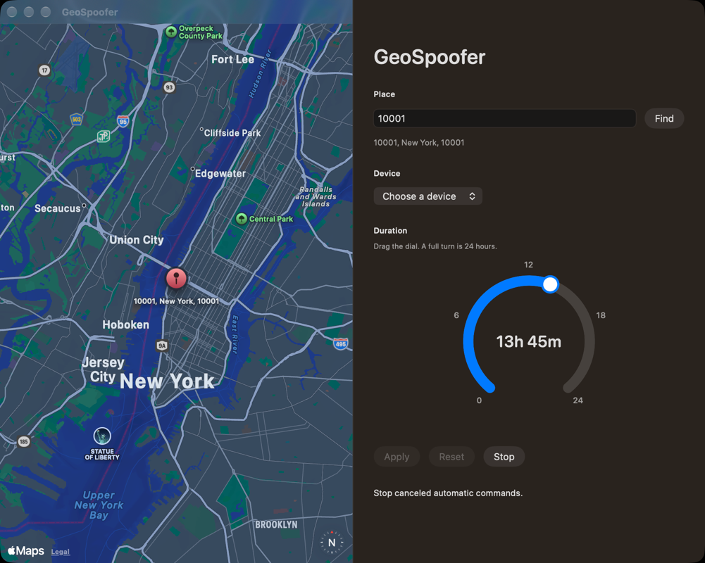

# GeoSpoofer

**Disclaimer.** GeoSpoofer is experimental software provided for software testing and development purposes only. It is furnished “AS IS,” without warranty of any kind, whether express or implied, including any warranty of merchantability, fitness for a particular purpose, or non-infringement.

By downloading, building, or using this software, you accept that you do so entirely at your own risk. You are solely responsible for how you use it, for complying with applicable law, and for complying with the terms of any device, platform, or service you test. You accept the risk of effects on your devices, accounts, data, and any third party. The authors and contributors disclaim liability for any claim, damage, or loss arising out of the use of, or inability to use, this software, to the fullest extent permitted by law.

This project is not affiliated with, endorsed by, or sponsored by Apple Inc. A location override is a software simulation. Apps and services may detect it. Do not use this software to misrepresent your location in order to commit fraud, break the law, or violate another party’s terms.

## Overview

GeoSpoofer is a Mac menu-bar app for trying a temporary, device-wide location on a connected iPhone or a booted iOS Simulator. You pick a place on a map, choose how long the override should last, and apply it. When that time is up, or when you press Reset, the device is returned to its live location.



Nothing is sent until you choose a device, a duration, and press Apply. The longest duration is 24 hours. Closing the window leaves the app running so it can clear the override on time. A full quit keeps the lease on disk; the next launch clears an expired override or restores one that is still in effect.

## What it does

- Shows a map where you can search for a ZIP code or place, or drop a pin.
- Lists connected iPhones and booted Simulators.
- Applies one location to the whole device through Xcode’s location simulation.
- Clears that location at the deadline, when you press Reset, or when you press Stop.
- Keeps a local Location Log of each attempt, retry, timeout, stop, and clear.
- Stops sending commands to a device after a failed attempt and three retries, until you Apply, Reset, or launch the app again.

An iPhone needs to be trusted, unlocked, and available to Xcode. A Simulator must already be booted. This Mac needs Xcode installed. The app does not include Xcode, and it does not reboot, erase, or change Developer Mode on a phone.

## How to use it

1. Install Xcode and point `xcode-select` at it.
2. Open GeoSpoofer. It stays in the menu bar after you close the window.
3. Search for a ZIP code or place, or click the map to drop a pin. If a search matches several places, pick one. The map moves to a single match.
4. Choose a device. If the list is empty, boot a Simulator or connect and trust an iPhone.
5. Drag the duration dial. The top of the dial is 12 hours and the far side is 24 hours.
6. Press Apply. The confirmation names the device and the expiration. Apps can still tell that the location is simulated.
7. Press Reset to return that device to its live location, or press Stop to cancel and clear every device the app can reach.
8. Open Location Log from the menu bar to read what was sent.

To pack a local disk image:

```bash
./scripts/make-dmg.sh
```

That build is unsigned and not notarized. On this Mac, right-click the app and choose Open if Gatekeeper asks. Signing for other Macs is left for later.

## Requirements

- macOS 14 or later
- Xcode, with `simctl` and `devicectl` available
- A booted iOS Simulator, or a trusted iPhone connected by cable or already paired on the network
